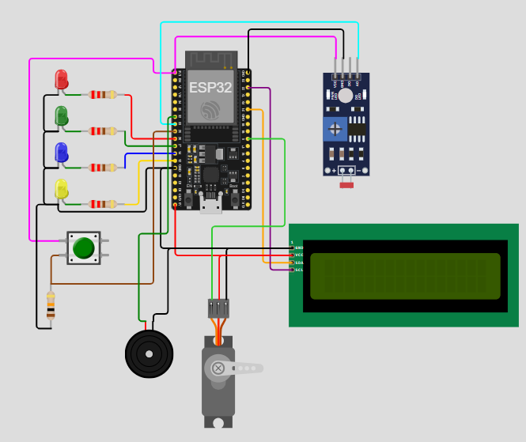

# IoT Labs: ESP32 (Arduino, PlatformIO, Wokwi)

My lab work for the IoT course at Turin Polytechnic University in Tashkent (TTPU, 2026). Each exercise is one ESP32 program, written in C++ with the Arduino framework. The programs run in the [Wokwi](https://wokwi.com) simulator or on a real board.

They start with LEDs and sensors, then move to Wi-Fi, HTTP and MQTT. In the last labs, two boards control each other's LEDs through an MQTT broker.

## Programs

| Program | File | PlatformIO env | What it does |
|---|---|---|---|
| LED chase | `src/ex1.cpp` | `ex1` | Lights RED → GREEN → YELLOW → BLUE → YELLOW → GREEN one at a time, 150 ms per step, and prints `chase=<LED>` |
| Light sensor statistics | `src/ex2.cpp` | `ex2` | Every second, reads the light sensor 10 times and prints `min=… max=… avg=…` |
| Threshold alert with hysteresis | `src/ex3.cpp` | `ex3` | Turns the alert on above 3000 and off below 2500, and prints `ALERT=1` / `ALERT=0` only when it changes |
| Button counter | `src/ex4.cpp` | `ex4` | Counts button presses from 0 to 4 with edge detection and lights that many LEDs |
| Light-activated buzzer | `src/ex5.cpp` | `ex5` | Turns the buzzer on when the light level goes above a threshold, and off when it drops back |
| Wi-Fi + HTTP | `src/lab_7_wifi.cpp` | `lab_7_wifi` | Connects to Wi-Fi, prints the local IP, and keeps asking an HTTP endpoint for commands like `redon` / `redoff` |
| MQTT tasks | `src/lab_8_.cpp` | `lab_8_wifi1` | Publishes a hello message to `ttpu/led`, prints the time from `time/now`, publishes button `pressed` / `released`, and switches LEDs on commands from `ttpu/<name>/led` |
| MQTT: two boards | `src/lab_8.cpp` | `lab_8_wifi` | Each button press moves the partner board's LEDs to the next colour. Also listens on its own topic, so the partner can control this board |
| MQTT: remote control | `src/lab_9.cpp` | `lab_9_wifi` | A button press sends the next LED command to the partner board's topic |

## Wiring

| Part | ESP32 pin |
|---|---|
| Red LED | D26 |
| Green LED | D27 |
| Blue LED | D14 |
| Yellow LED | D12 |
| Button (active high) | D25 |
| Light sensor (analog) | D33 |
| Buzzer | D32 |
| LCD I2C | SDA D21, SCL D22 |
| Servo | D5 |



## Run

1. Install VS Code with the PlatformIO and Wokwi extensions.
2. For the Wi-Fi and MQTT labs, copy `src/secrets.example.h` to `src/secrets.h` and fill in your Wi-Fi and MQTT credentials. `src/secrets.h` is ignored by git.
3. Choose an environment from the table (or set `default_envs` in `platformio.ini`), then build:
   ```bash
   pio run -e ex1
   ```
4. Start the Wokwi simulator, or upload to a board with `pio run -e ex1 -t upload`.

## Stack

ESP32 · C++ / Arduino · PlatformIO · Wokwi · WiFi · HTTPClient · PubSubClient (MQTT)
